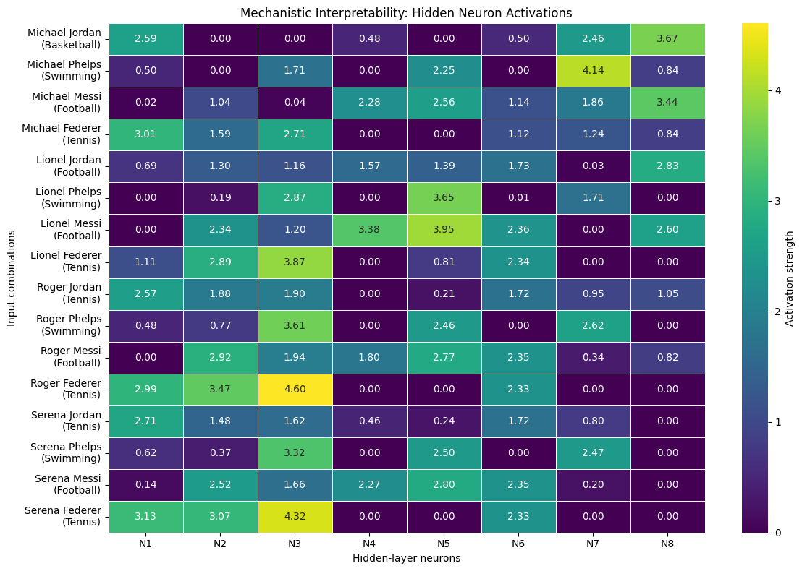

A simple feedforward neural network was implemented using PyTorch to predict sports based on first-name and last-name combinations. A dataset containing 16 combinations was created, and the model was trained to classify each combination into one of four sports: Basketball, Swimming, Football, or Tennis.

The activations of the eight hidden-layer neurons were extracted and analyzed across all 16 inputs. Particular attention was given to neuron N8, whose activation patterns were examined by first name, last name, and sport to investigate its learned features. An additional neuron, N9, was trained to identify "Michael Jordan" without modifying the original network, demonstrating a basic approach to feature specialization.

Shows the activations of each neuron for all 16 inputs.

BTW my favorite sportperson is Lionel Messi :)